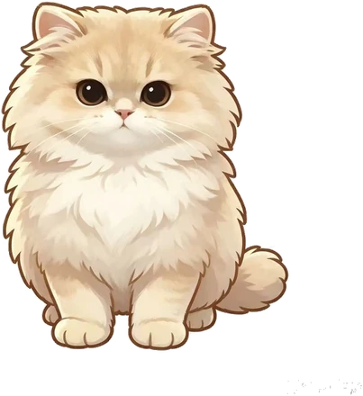
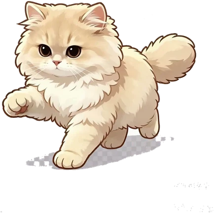
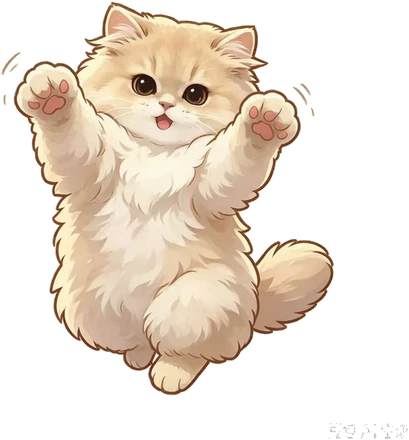
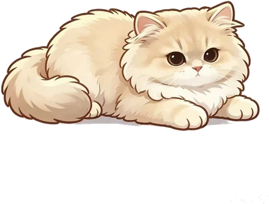

<p align="center">
  
  
  
  
</p>

<h1 align="center">CreamCat 奶油猫 · 桌面精力宠物</h1>

<p align="center">
  事件溯源精力管理 × 天气情绪 × 可换皮肤桌面猫<br>
  一只住在桌面底边的奶油猫，它的活力与心情，由你的精力账本驱动。
</p>

<p align="center"><b>「猫不汇报数据，猫就是数据。」</b></p>

---

## 这是什么

CreamCat 是一个 Electron 桌面应用。平时桌面上只有一只猫——自己散步、舔毛、打盹、跳上窗口顶边踱步；你拖它、甩它、摸它，敲键盘时它抬爪陪你打节拍（Bongo Cat）。

猫的身体语言就是你的精力状态：精力高 → 活泼好动、被摸时撒爱心；精力低 → 懒得动、倒头就睡；天气变化 → 头顶挂奶油线稿小天气（晴/云/雨/雷）。所有确认类 UI（晨间滑动卡、事件后调节窗、任务时长卡、周报、AI 推荐）以**奶油纸感卡片**呈现在独立窗口，按需出现、用完即隐。

## 核心设计：双层通道 🔴

| | 情绪通道 | 中心通道 |
|:--|:--|:--|
| 载体 | 猫的身体（连续参数：轮廓/眼/嘴/呼吸/弹跳…） | HUD 精力条（10 格） |
| 精度 | 故意模糊，只读出「大概什么状态」 | 精确到 0.1 分 |
| 职责 | 陪伴、共情、被看见 | 校准、决策依据、事实核对 |

三条不可协商的红线：

- 宠物本体**永不出现文字**——文字只在用户主动展开的面板/卡片里
- 禁止用情绪通道承担精确读数（会制造无来源的焦虑），禁止给 HUD 加表情（仪表一旦「表达情绪」就不再可信）
- 任何状态（锁定/低精力/跌倒）都**不隐藏** 10 格精力条

设计取舍的完整论证见 [DESIGN.md](DESIGN.md)（设计契约，唯一仲裁处）。

## 功能一览

- 🐱 **桌面奶油猫** — 行走/舔毛/打盹/登高状态机；拖拽甩出物理、顶边吸附踱步、摸头、Bongo 敲键陪打
- ⚡ **事件溯源精力账本** — append-only 事件流 + fold 折叠出精力值，SQLite 持久化
- 🎭 **情绪引擎** — 精力/天气/事件 → 连续身体语言参数 + pulse 强度调制契约
- 🌤 **天气情绪** — IP 定位 + 天气源，头顶线稿小天气挂件
- 💌 **皇室书信卡** — 晨间基线滑动卡、事件后调节窗（拖动重置倒计时）、任务时长卡、定时周报（17:30）、AI 推荐堆叠
- 🎨 **可换皮肤** — 图像皮肤包（`skin.json` v2，多姿态帧），程序化线稿猫兜底
- ✂️ **AI 毛发定制工坊** — 官网上传自家猫照片，千问图像编辑生成七姿态定制皮肤包（厚涂 Q 版 / 扁平 Q 版 / 像素风三画风）
- 🤸 **姿势包** — JSON 丢进 `poses/` 目录 700ms 防抖热加载，右键「摆个姿势」播放
- 🖥 **双窗口架构** — `catWin`（360×380，随猫行走）+ `uiWin`（400×620，卡片流按需显隐），click-through 命中区 50ms 轮询

## 快速开始

```bash
npm install
npm run dev        # esbuild 构建 + Electron 启动（--dev）
npm test           # 构建测试 + node --test 全量跑
npm run typecheck  # tsc --noEmit（strict）
```

打包发行：

```bash
npm run build:mac  # electron-builder mac universal dmg（含原生 helper）
npm run build:win  # Windows NSIS 安装包
npm run release    # 发行装配 + 官网下载页同步
```

官网本地预览：

```bash
npm run site:dev   # 起 site/ 下载页（含 AI 毛发定制工坊）
```

## 项目结构

```
src/
├── core/       # L0 契约层：types / events / bus / hittest（零依赖根）
├── ledger/     # 事件溯源精力账本（events → fold）
├── emotion/    # 情绪引擎 + pulse 契约
├── main/       # Electron 主进程：coordinator / 双窗口 / 姿势 / 皮肤 / 顶边 / 自启动
├── renderer/
│   ├── cat/    # 奶油猫渲染层（FSM / 步态 / mood 映射 / sprite-skin）
│   └── ui/     # 奶油卡片流 UI
├── weather/    # IP 定位 + 天气源
├── storage/    # SQLite
├── task/       # 任务中心
├── recovery/   # 恢复项卡组
└── insight/    # 洞察周报
site/           # 官网下载页 + AI 毛发定制工坊
skins/          # 图像皮肤包（skin.json v2）
poses/          # 自定义姿势包（JSON 热加载）
tests/          # node:test 测试
docs/           # L2 模块存根与专题文档
```

## 文档地图

| 文档 | 内容 |
|:--|:--|
| [DESIGN.md](DESIGN.md) | 设计契约：红线/定调/现状，设计冲突的唯一仲裁处 |
| [STRUCTURE_MAP.md](STRUCTURE_MAP.md) | 全局结构地图（L1 入口）：目录树、依赖图、不变式、修改指引 |
| [docs/cream-fusion.md](docs/cream-fusion.md) | 奶油猫 × 精力桌宠融合设计 v2.0（双窗口架构决策） |
| [docs/structure/](docs/structure) | 各模块接口存根（与 `src/` 文件 1:1） |
| [docs/pose-plugins.md](docs/pose-plugins.md) | 姿势包格式、校验与热加载 |
| [docs/cat-studio.md](docs/cat-studio.md) | AI 毛发定制工坊 |
| [poses/README.md](poses/README.md) | 姿势包快速上手 |

阅读顺序建议：**README → STRUCTURE_MAP（L1）→ 对应模块存根（L2）→ 源码（L3）**。

## 技术栈

TypeScript（strict）· Electron · esbuild · node:test · SQLite · electron-builder
